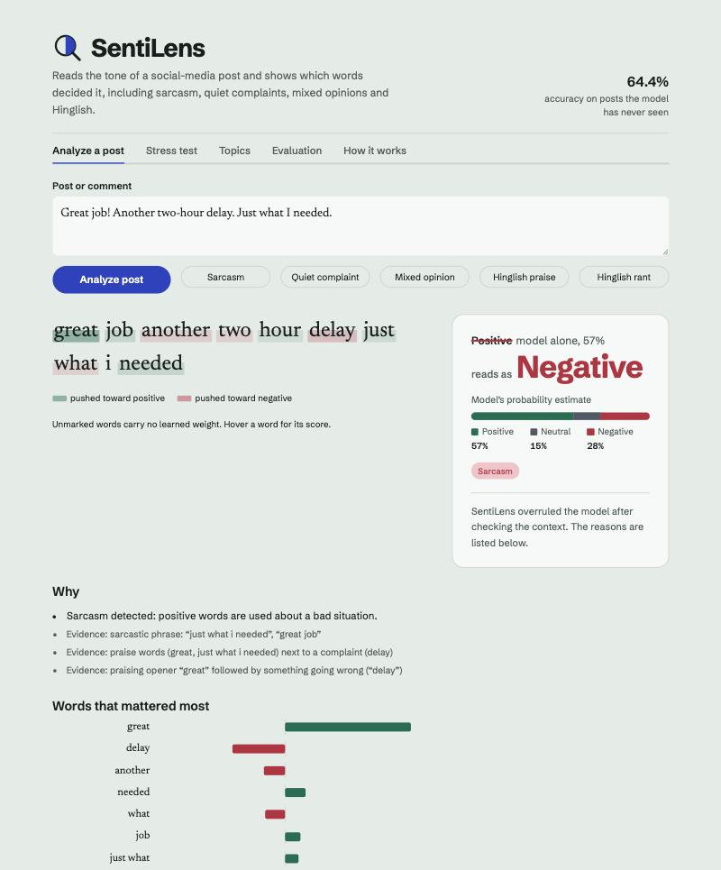
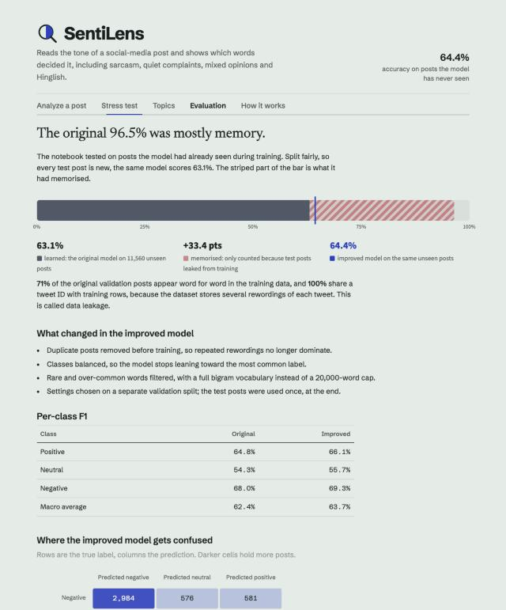
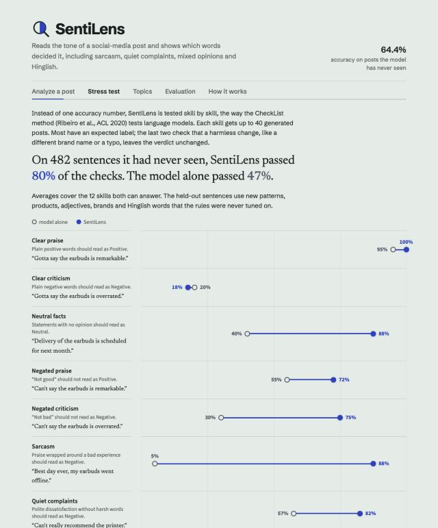

# SentiLens — context-aware sentiment analysis
link https://github.com/Pradeep2428/social-media-sentiment-analysis
A social-media sentiment analyzer that **explains every prediction**, **tests itself honestly**, and
reads **Hinglish** (Hindi-English code-mix). Built on classic TF-IDF + Logistic Regression, with a
transparent rule layer on top — no black box.

> Most student sentiment projects report one big accuracy number. This one shows that its original
> 96.5% was mostly data leakage (really ~63% on unseen posts), measures itself skill by skill, and
> makes a *measured* improvement on Indian code-mixed text.



Built with Python, scikit-learn and Streamlit.

---

## What makes it different

- **Explains itself.** Every word is highlighted by how much it pushed the verdict, straight from the
  model's own Logistic-Regression weights — not a separate explainer library.
- **Reads context the bag-of-words model can't.** Sarcasm, quiet complaints ("wouldn't recommend"),
  "not bad" = good, mixed opinions, Hinglish and emoji.
- **Honest evaluation.** A data-leakage audit, a CheckList-style behaviour test suite with a held-out
  split, and a check of whether the rules help or hurt on *real* tweets.
- **Hinglish, measured on real data.** 338 Hinglish opinion words learned from the SemEval-2020
  SentiMix dataset, scored on its held-out test set and on an unrelated YouTube-comments dataset.

## Three results worth knowing

**1 · The original 96.5% was mostly memory.** 71% of the original validation posts appear word-for-word
in the training data (100% share a tweet ID). Split fairly, the same model scores **63.1%**; the
improved model scores **64.4%** on 11,560 unseen posts.



**2 · Tested skill by skill, not with one number.** On 482 generated sentences it had never seen,
SentiLens passes **80%** of the behaviour checks vs **47%** for the model alone (averaged over the 12
comparable skills). Big gains on sarcasm (5% → 88%) and Hinglish (28% → 90%).



**3 · Hinglish, +9 points.** Learning Hinglish opinion words lifts SemEval-2020 test accuracy from
**46.0%** (English model alone) to **54.9%**. A model trained directly on Hinglish sets the ceiling at
66.1%.

## Features

| Tab | What it does |
|---|---|
| **Analyze a post** | Verdict, per-word explanation, class probabilities, clause-by-clause breakdown |
| **Stress test** | CheckList-style behaviour tests, held-out vs practice split, per-skill pass rates |
| **Topics** | Upload a labelled CSV → most-discussed topics and sentiment mix per topic |
| **Evaluation** | Leakage audit, honest accuracy, per-class F1, confusion matrix, real-tweet impact, Hinglish results |
| **How it works** | The pipeline and its limitations, in plain language |

## Run it

```bash
python3 -m venv .venv
source .venv/bin/activate          # Windows: .venv\Scripts\activate
pip install -r requirements.txt
streamlit run app.py
```

Run it from the project folder so the theme in `.streamlit/config.toml` is applied. The app opens in
your browser. The Analyze, Stress-test and Evaluation tabs work out of the box — the trained model and
all the result files are included. The Hinglish test data is downloaded automatically the first time
you open the Evaluation tab's experiments.

## How the evaluation was kept honest

- Every tuning step used a **development split**; each **test split was used once**, at the end.
- Behaviour tests: rules were improved on a practice split; a **held-out split** (new sentence patterns,
  products, adjectives, brands and Hinglish words) was written *before* the rule changes and run once.
  Practice 94% vs held-out 80% shows how much the rules overfit — reported, not hidden.
- Real tweets: the rules fix about as many posts as they break (473 vs 469), so they don't inflate real
  accuracy while clearly helping on the cases they target.
- Hinglish: the word list was learned from SemEval **train**, its settings chosen on SemEval **dev**,
  then scored once on SemEval **test** and on YouTube comments (never used for tuning). Names and
  religious / community / gender / political words were removed from the learned list (103 words).

## Project structure

```
app.py                     Streamlit app (5 tabs)
smart_layer.py             Context layer: translation, brand masking, explanations, rules
behaviour_tests.py         CheckList-style behaviour test suite (practice + held-out splits)
lab_experiments.py         Model selection + real-tweet and Hinglish experiments (run via ?lab=...)
sentiment_model.pkl        Improved TF-IDF + Logistic Regression model (+ *_original.pkl for comparison)
tfidf_vectorizer.pkl
vader_lexicon.txt          VADER opinion lexicon (Hutto & Gilbert 2014, MIT) + VADER_LICENSE.txt
hinglish_lexicon.json      338 Hinglish opinion words learned from SemEval SentiMix
*_report.json / *_eval.json / real_*.json   Saved evaluation results shown in the app
```

## Data

The raw training CSVs are **not** included (size and dataset licensing). The app ships the trained model
and the computed result files, so it runs and shows all results without them. To re-run the training and
experiments:

- **English model:** [Twitter Entity Sentiment Analysis](https://www.kaggle.com/datasets/jp797498e/twitter-entity-sentiment-analysis)
  (Kaggle). Place `twitter_training.csv` / `twitter_validation.csv` in an `archive/` folder next to this one.
- **Hinglish:** SemEval-2020 Task 9 (SentiMix) and a Hinglish YouTube-comments set are downloaded
  automatically from Hugging Face by `lab_experiments.py`.

## Limitations

- The context checks are **hand-written rules**: they catch common patterns, not every sarcastic post.
- Hinglish support is a learned word list, not a trained language model.
- Rare negative words the model never saw (e.g. "shoddy", "subpar") and some negation patterns
  ("can't say it's great", "far from bad") are still misread.
- Base accuracy (~64%) reflects a noisy, entity-specific dataset; a transformer would score higher but
  wouldn't be explainable the same way, and wouldn't have surfaced the leakage.

## Credits

- Dataset: Twitter Entity Sentiment Analysis (Kaggle) · SemEval-2020 Task 9 SentiMix (code-mixed tweets)
- VADER sentiment lexicon — Hutto & Gilbert, 2014 (MIT License)
- Behaviour-testing idea — Ribeiro et al., *Beyond Accuracy: Behavioral Testing of NLP Models with
  CheckList*, ACL 2020

## License

MIT — see [LICENSE](LICENSE).
